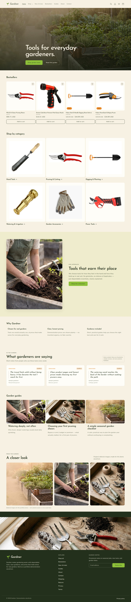

# Gardner

A portfolio-quality Shopify Online Store 2.0 theme for a fictional garden-tools storefront. Gardner is a design and engineering study: an editorial retail experience built on Dawn, with custom sections, original copy, responsive layouts, accessible interactions, and automated QA.



## Project status

| Item | Status |
|---|---|
| Project type | Personal portfolio / development project |
| Storefront | Unpublished and password-protected |
| Published theme | Horizon (unchanged) |
| Gardner theme | `191259083065` (unpublished) |
| Repository | [jewelcruzs0922-dev/gardner-shopify-theme](https://github.com/jewelcruzs0922-dev/gardner-shopify-theme) (private) |
| Portfolio readiness | Ready with documented limitations |
| Commercial readiness | Not ready |

Gardner is not a live business. No real orders are fulfilled, no customer data was submitted, and no product-image rights are claimed.

## What this project demonstrates

- **Shopify theme engineering:** Dawn 16.0.0, Online Store 2.0 sections, JSON templates, theme settings, and native commerce components.
- **Editorial frontend design:** custom brand layer, responsive image treatment, sticky navigation, mega menu, scroll-reveal motion, and a mobile-first layout.
- **Commerce UX:** collection filtering and sorting, product galleries, quantity controls, cart drawer, cart fallback, predictive search, and browser-local wishlist.
- **Accessibility:** semantic landmarks, keyboard focus states, labelled controls, reduced-motion support, and automated axe checks across pages and interactive states.
- **Quality engineering:** Playwright functional tests, SEO/structured-data checks, Theme Check, Lighthouse diagnostics, screenshot capture, and documented evidence.
- **Secure handoff:** ignored local secrets, sanitized documentation, reproducible setup, and a clean private GitHub repository.

## Feature highlights

### Storefront

- Full-bleed editorial hero with responsive imagery and two calls to action
- Bestsellers, six category cards, new arrivals, brand story, three-tool starter kit, benefits, testimonials, FAQ, guides, and editorial gallery
- Mega menu with collection links and featured products
- Hide-on-scroll sticky header with search, account, wishlist, and cart
- Predictive search with product thumbnails, results page, and empty state
- Collection filtering, sorting, active-filter chips, and responsive product grids
- Product detail pages with gallery lightbox, trust strip, related products, and inventory states
- Cart drawer with quantity updates and removal, plus a cart-page fallback
- Browser-local wishlist with persistence, empty state, and product/card toggles
- About, Contact, Wishlist, Guides, article, policy, and 404 pages
- Demo reviews and gallery content are visibly labelled as demonstration/editorial material

### Design system

The live palette is defined in `assets/gardner.css`:

| Token | Value | Role |
|---|---|---|
| Cream | `#F7F1E3` | Main page background and light text |
| Sage | `#EFEBCD` | Secondary section and card surfaces |
| Apple green | `#8DBF39` | Primary brand and CTA color |
| Lemon yellow | `#F4E24C` | Accent, hover, and highlight states |
| Deep ink green | `#1E2A16` | Primary text and dark sections |
| Soft ink | `#4A5540` | Secondary text |

Typography uses Josefin Sans for headings and Manrope for body copy through Shopify's font CDN. The theme has no external Google Fonts request.

## Technology

| Layer | Implementation |
|---|---|
| Theme foundation | Shopify Dawn 16.0.0 |
| Theme model | Online Store 2.0 sections, blocks, and JSON templates |
| Styling | Dawn component CSS plus `assets/gardner.css` |
| JavaScript | Native custom elements, Dawn interaction primitives, and custom wishlist/scroll/gallery scripts |
| Testing | Playwright, axe-core, Lighthouse, Shopify Theme Check |
| Runtime | Node.js 20+; verified with Node 26.8.1 |
| Hosting | Shopify development store (private preview) |

There is no application build step. The theme is pushed directly to Shopify.

## Repository layout

```text
.
├── assets/       Theme CSS, JavaScript, icons, and responsive editorial images
├── config/       Theme settings, color schemes, and brand configuration
├── data/         Catalog seed data and research candidates
├── docs/         Architecture, QA evidence, decisions, and case study
├── layout/       Theme shell and password layout
├── locales/      Storefront translations
├── scripts/      Seeding, inventory, QA, screenshots, and performance tooling
├── sections/     Header, footer, homepage, product, collection, cart, and content sections
├── snippets/     Cards, facets, media, SEO, breadcrumbs, and UI helpers
└── templates/    JSON templates for all page types
```

## Getting started

### Requirements

- Node.js 20 or newer
- Shopify CLI 4.x
- A Shopify development store
- An unpublished theme in that store
- A store-scoped Admin API token for catalog/content scripts

### Install

```powershell
npm install
Copy-Item .env.example .env
```

Fill in the local values in `.env`:

```dotenv
SHOPIFY_STORE=your-store.myshopify.com
SHOPIFY_ADMIN_TOKEN=your_store_scoped_token
SHOPIFY_API_VERSION=2026-10
SHOPIFY_STOREFRONT_PASSWORD=your_private_storefront_password
```

`.env` is gitignored. Never commit it, paste it into a terminal transcript, or include it in an archive. The Admin token needs the scopes required by the catalog/content scripts in this repository.

### Preview

- **Theme editor:** `https://admin.shopify.com/store/gardner-dev-zwlohenx/themes/191259083065/editor`
- **Storefront preview:** `https://gardner-dev-zwlohenx.myshopify.com/?preview_theme_id=191259083065`
- The storefront is password-protected; the password is stored only in `.env`.

**Do not publish the theme or store.** The published theme remains Horizon and was not modified.

### Push the unpublished theme

```powershell
$env:SHOPIFY_CLI_THEME_TOKEN = ((Get-Content .env | Where-Object { $_ -like 'SHOPIFY_ADMIN_TOKEN=*' }) -split '=',2)[1]
shopify theme push --theme 191259083065 --path . --store gardner-dev-zwlohenx.myshopify.com
```

## Commands

```powershell
# Theme Check (0 errors expected; inherited Dawn warnings remain)
npm run lint

# Theme Check without failing on warnings
npm run check

# Functional QA: desktop, tablet, mobile, interactions, screenshots
npm run qa

# axe accessibility scan: 13 pages plus 5 interactive states
npm run qa:a11y

# SEO and structured-data checks
npm run qa:seo

# Lighthouse performance diagnostics
$env:CHROME_PATH = "C:\Program Files\Google\Chrome\Application\chrome.exe"
node scripts/perf.mjs

# Demo inventory states
node scripts/set-stock.mjs

# Regenerate catalog research documentation
node scripts/gen-catalog-doc.mjs
```

## Verification summary

Latest verified results are in [`docs/qa/`](docs/qa/). Full details and historical context are in [`docs/TEST-REPORT.md`](docs/TEST-REPORT.md).

| Check | Result |
|---|---|
| Theme Check | **0 errors**, 9 inherited warnings across 178 files |
| Functional QA | **31 passed / 0 failed / 1 blocked** |
| Accessibility (axe) | **0 automated violations** across 13 pages and 5 states |
| Automated incompletes | 70 contrast nodes, 3 `aria-prohibited` nodes, 3 `aria-valid` nodes; manual review remains |
| SEO / structured data | **20 / 20 passed** |
| Responsive | No horizontal overflow at 1440, 768, or 390 on home, collection, or product |
| Internal links | 83 checked, 0 broken; one expected account redirect |
| Dependency audit | 0 known vulnerabilities |
| Browser coverage | Chromium only; Safari, Firefox, and Edge were not tested |
| Newsletter | End-to-end submission blocked by Shopify's invisible hCaptcha |
| Lighthouse | Desktop 95; mobile 47.5–53 with preview/platform overhead; theme-only 67–72 |

The mobile Lighthouse results include Shopify preview bar, Shop Pay/cart-sync, checkout assets, web pixels, and analytics. The theme-only diagnostic is an estimate of theme contribution, not a storefront score.

## Documentation

- [`docs/PROJECT-PLAN.md`](docs/PROJECT-PLAN.md) — milestones and current state
- [`docs/ARCHITECTURE.md`](docs/ARCHITECTURE.md) — theme structure and implementation notes
- [`docs/THEME-DECISION.md`](docs/THEME-DECISION.md) — why Dawn was selected
- [`docs/REFERENCE-INVENTORY.md`](docs/REFERENCE-INVENTORY.md) — reference observations and visual notes
- [`docs/catalog-research.md`](docs/catalog-research.md) — product research, sources, pricing, and image-rights notes
- [`docs/TEST-REPORT.md`](docs/TEST-REPORT.md) — functional, accessibility, SEO, and performance results
- [`docs/VISUAL-QA.md`](docs/VISUAL-QA.md) — matched-viewport visual checks
- [`docs/KNOWN-LIMITATIONS.md`](docs/KNOWN-LIMITATIONS.md) — limitations and owner actions
- [`docs/READINESS-CHECKLIST.md`](docs/READINESS-CHECKLIST.md) — portfolio and commercial readiness
- [`docs/SECURITY-NOTES.md`](docs/SECURITY-NOTES.md) — credential handling and remediation record
- [`docs/CASE-STUDY.md`](docs/CASE-STUDY.md) — portfolio case study
- [`docs/qa/`](docs/qa/) — screenshots, axe report, Lighthouse reports, and functional/SEO JSON evidence

## Security and privacy

- `.env` is ignored by Git and is not included in the handoff archive.
- `.env.example` contains placeholders only.
- `.playwright-mcp`, `.tmp`, `.git`, `node_modules`, and local ZIPs are excluded from the repository.
- The store remains private and password-protected.
- Exposed credentials from earlier setup were rotated; see [`docs/SECURITY-NOTES.md`](docs/SECURITY-NOTES.md).
- Rotate the Admin API token and remove the temporary "Gardner Admin" app after archiving the project.

Secret scans are not proof that every possible secret is absent. They are a verification step, not a guarantee.

## Known limitations

- Product images are sourced from brand/retailer listings and **usage rights are not licensed**. Replace them or obtain permission before commercial use.
- Prices, inventory, testimonials, and gallery content are demonstration material, not verified business data.
- Reviews and gallery content are visibly labelled as demo/editorial content.
- Shipping, Returns, Privacy, and Terms pages are drafts, not legal advice.
- The newsletter cannot be submitted end to end in automation because of Shopify's invisible hCaptcha.
- The contact form was not submitted to avoid creating customer data.
- Checkout, payments, taxes, shipping rates, customer accounts, and multi-variant selection were not exercised.
- Screen-reader, physical-device, and non-Chromium browser testing remain outstanding.
- The mobile Lighthouse score is limited by Shopify preview/platform overhead.

See [`docs/KNOWN-LIMITATIONS.md`](docs/KNOWN-LIMITATIONS.md) for the complete list and owner actions.

## License and attribution

The theme is built on Shopify Dawn 16.0.0. The repository's [`LICENSE.md`](LICENSE.md) contains the Shopify theme license and its restrictions. Gardner's original sections, styling, copy, and scripts are provided as a portfolio project.

The Lavandula Webflow site was used only as a rendered visual reference. No Lavandula code, copy, fonts, or image assets were reused. Product imagery is not covered by the theme license and remains subject to the rights of the original brand/retailer.

## Portfolio note

Gardner is intended to demonstrate end-to-end Shopify theme work: design implementation, responsive commerce UX, accessibility, automated QA, performance analysis, secure handoff, and documentation. It is deliberately kept unpublished and private until the owner decides otherwise.
